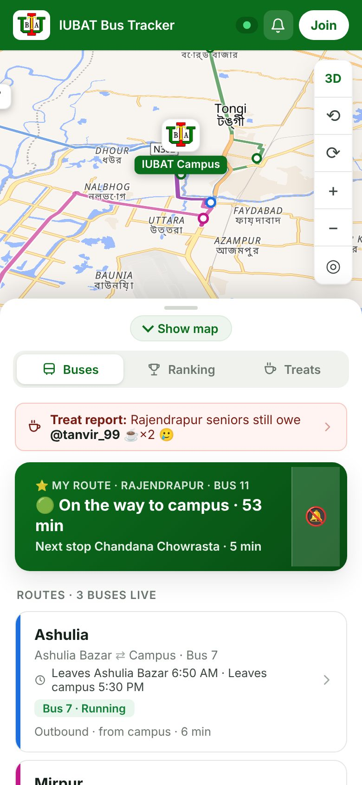
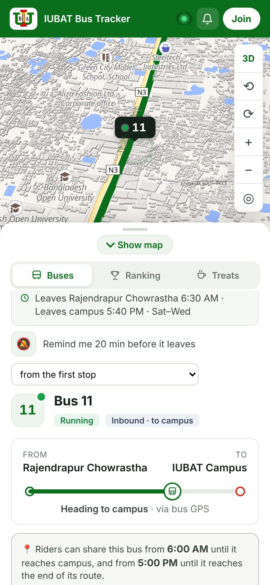
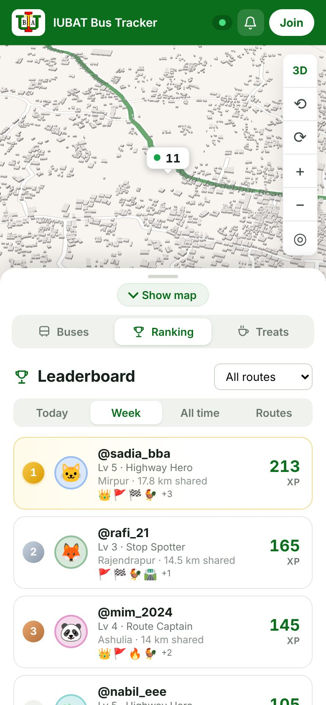
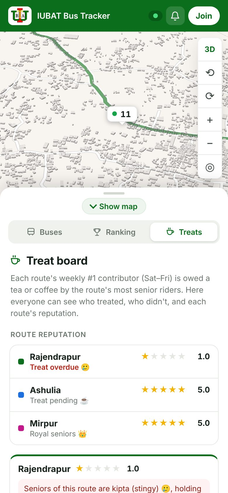
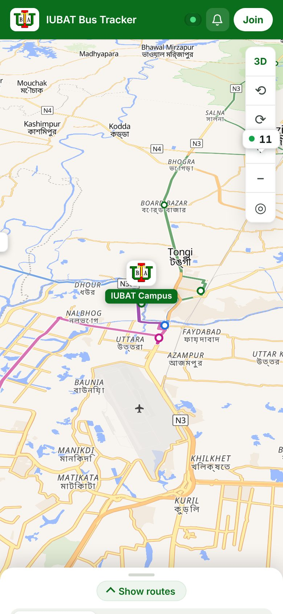
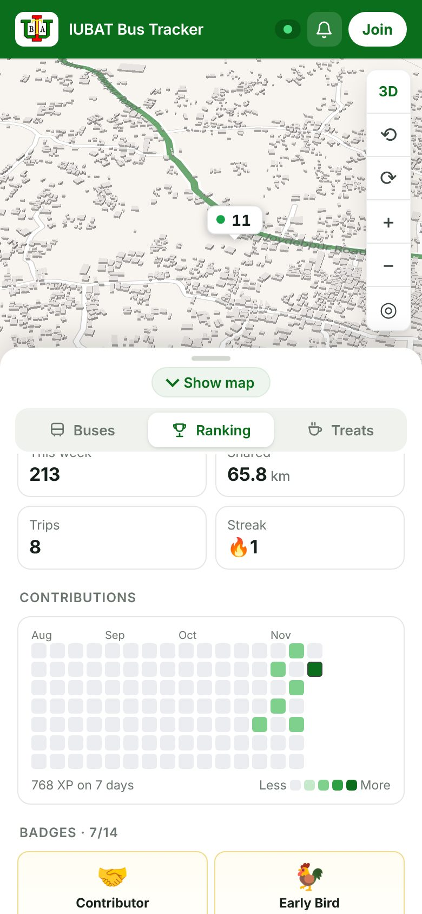

<div align="center">


# IUBAT Bus Tracker

**Where is my campus bus right now?** A live, crowd-powered bus tracker built by students, for students.<br>
Open to everyone, free to run, and ready to fork for your own university.

[**Live app**](https://bustracker.iubat.workers.dev) · [▶ 1-minute demo video](docs/media/promo.mp4) · [Use it at your university](#use-it-at-your-university) · [Features](#features) · [How it works](#how-it-works)


-f38020)
-4ff8d2)


<sub>If this helps your campus, a ⭐ on GitHub helps other students find it.</sub>

   

</div>

## Why
Every morning the same question goes around every group chat: *"Has the bus left yet?"* Universities rarely have a tracking system,
and buying GPS hardware takes years. This project needs **no hardware and no budget**: the students on the bus share its location
from their phones (checked automatically, so nobody can fake it from home), everyone else sees the bus live on a 3D map, and
the sharers are rewarded with XP, badges, a leaderboard and (the fun part) a weekly cup of tea owed by the seniors of their route.

## Features
| | |
|---|---|
| 🗺️ **Live 3D map** | Every route and bus, where it is, where it is going, next stop, ETA; timetable estimate when no one is sharing |
| 📍 **Crowd-sourced location** | Riders share from their phone; the server verifies it (on the route, moving like a bus, no jumps) |
| ⏰ **Reminders** | Web Push 20 minutes before your bus leaves (from *your* stop), even with the app closed |
| 🏆 **XP, levels, badges** | 10 XP per km, 14 badges, GitHub-style contribution graph, daily / weekly / all-time ranking |
| ☕ **Treat board** | Each route's weekly champion is owed tea by the seniors; unpaid treats lower the route's public rating 🥲 |
| ⚔️ **Route battle** | Monthly: which route keeps the most of its trips live? |
| 💺 **Seats** | Riders report free seats in one tap |
| 📅 **University calendar** | Normal week + exam days / holidays; double-XP weeks |
| 🛡️ **Admin dashboard** | Routes & stops (bulk paste, auto-locate), buses, notices (+push), photo moderation, feedback inbox |
| 🔑 **No passwords** | Pick a username; a device key + recovery code identify you. Student-ID linking is prepared |
| 💸 **Free to run** | Cloudflare Workers + Turso free plans, OpenStreetMap tiles, no paid APIs |

<p align="center"> </p>

## Use it at your university
You can run your own copy in about 30 minutes, for free. No server to manage.

1. **Fork** this repository (button at the top right) and clone your fork.
2. **Your campus**: edit [`server/_config.js`](server/_config.js) (name, campus location, site URL, time zone).
   Branding: replace `assets/logo.png` and the icons in `assets/icons/`, and change the name in `index.html`, `manifest.webmanifest`,
   `admin/index.html` and `privacy.html` (search for `IUBAT`). Brand colour: `--green` in `css/style.css`.
3. **Database**: create a free [Turso](https://turso.tech) database; note its URL and token.
4. **Hosting**: create a free Cloudflare Worker connected to your fork (Workers Builds), with secrets `TURSO_DATABASE_URL`,
   `TURSO_AUTH_TOKEN`, `SESSION_SECRET` (any long random text). Every push then deploys automatically. Details: [Production](#production-cloudflare-workers--turso-free-plans).
5. **First admin**: `TURSO_DATABASE_URL=… TURSO_AUTH_TOKEN=… node db/seed.js --no-demo` then `node db/seed.js --admin <name> <password>`.
6. Open `/admin/`, add your routes (paste the stop list from your bus schedule), buses and departure times. Share the link with students.

**Time zone**: the app assumes one time zone for the whole campus (`utcOffsetHours` in `server/_config.js`, sent to the app automatically).

### Credit & community
This project is MIT licensed: use it, change it, ship it. If it helps your campus:
- ⭐ star the repository, so other students searching for a campus bus tracker can find it;
- keep the small *"Open source · build one for your university"* link in the app footer, so the next university can find it too;
- open a pull request adding your university to the list below (with your live link). Every campus on the list makes the project more useful for the next one;
- improvements you make for your campus (new features, translations, fixes) are very welcome as pull requests: see [CONTRIBUTING.md](CONTRIBUTING.md).

**Universities using it**
| University | Link |
|---|---|
| IUBAT (International University of Business Agriculture and Technology), Dhaka | [bustracker.iubat.workers.dev](https://bustracker.iubat.workers.dev) |
| *Your university?* | *Add it with a pull request* |

## How it works
```
Riders' phones ──verified GPS──▶ /api/share ─┐
Bus phone (optional) ──GPS────▶ /api/track ─┼─▶ Turso (SQLite at the edge)
                                            │
Students' app ◀──poll 8–60 s── /api/buses ──┘      Cron (every minute) ──▶ Web Push reminders
Admin dashboard ──▶ /api/admin                     Map: MapLibre + OpenFreeMap (OpenStreetMap), routes snapped with OSRM
```
Plain JavaScript, no framework and no build step: `index.html` + `js/` (app), `api/` (serverless handlers that run on Cloudflare Workers,
Vercel or the local dev server), `admin/` (dashboard), `sw.js` (offline shell + push).

## Run locally
```sh
npm install
npm run seed        # local.db + a starter route / Bus 11 + demo admin + tracker token (.bus-tokens.json)
npm run dev         # http://localhost:3000   (admin: /admin/)
npm run simulate    # another terminal: fake GPS from the bus phones, driving both directions
```
One dummy student login (`2025001` / `demo1234` locally) exists only to view the prototype. Remove it with `node db/seed.js --remove-dummy`.
Demo admin (local only): `admin` / `admin1234`.

## Install as an app
The site is a Progressive Web App: on Android, Chrome shows **Install app** (button in the top bar) and the tracker opens full-screen
from the home screen with the IUBAT icon; on iPhone use Share, then Add to Home Screen. MapLibre and three.js are served from `/vendor`,
so the app does not depend on third-party CDNs (only map tiles and fonts are external).

## Pages
| Path | What |
|---|---|
| `/` | Open app: routes, my-route countdown, bus detail, 3D map, leaderboard, profiles |
| `/admin/` | Admin dashboard: **Buses** (number, route, departure times, tracker token), **Routes** (stops on a map, saved snapped to roads), **Notices** (broadcast to all apps, optional expiry) |
| `/privacy.html` | What the app does with sign-in and location data |
| `/tracker/` | **Bus phone** (a dedicated phone that stays on the bus, not the driver's own phone): sends GPS every 10 s with the bus's token; this official signal has priority over riders. Or use the **Traccar Client** app: Server URL `https://<site>/api/osmand`, device identifier = bus token. *Built and tested; not launched yet.* |

## Admin: how to set up a bus
1. **Routes → New route** (or pick a route): add stops *in driving order from the far end*; the route always ends at IUBAT Campus.
   - **Add stops in bulk**: paste the stop list from the schedule sheet, one per line, with an optional pick-up time
     (e.g. `BIPSOT 6:32 AM`). Each stop is looked up on OpenStreetMap near the route (spelling variants are tried); found stops are
     marked **Check**, unfound ones **No location**: press 📍 **Place** and click the map. Drag any marker to correct it.
   - Or click the map, or search a place and press **Add as stop**.
   - Pick-up times are shown to students and make the "Estimated" position follow the real timetable stop by stop.
   - On save the route is snapped to roads; if it is implausibly long you get a warning (a stop is probably misplaced or out of order).
2. **Buses → Add bus**: enter the bus number, pick the route. A **tracker token** is shown once; open the link on the bus phone.
3. Changing a bus number or route in the table takes effect in student apps within a few seconds (no reload).

The starter Rajendrapur route (Bus 11) starts at **Pepsi Gate, Rajendrapur Bazar** and joins the highway at Rajendrapur Chowrastha; add the other stops
in the admin dashboard. Existing databases whose Rajendrapur route still started at Chowrastha are corrected once automatically (`server/_fixes.js`).

**Extend or shorten a route**: in *Routes*, a stop added by clicking the map (or from search) goes to the **best position** (least detour), so a point
beyond the current start becomes the new start. *⤒ Extend start* makes the next click the first stop; *✂ Shorten start* removes the first stop.
The first stop is marked **START** on the map. Save to re-snap the route to the roads.

## Crowd mode: students share the bus location
A signed-in student on the bus can tap **Share location** on that bus's page. No extra bus device is needed; others then see the bus move.
Every fix is checked on the server (`server/share.js`) before anyone else sees it:
- GPS accuracy must be 60 m or better, and the phone must be within about 80 m of the route's road;
- it must travel at least 400 m along the route over at least 90 s at vehicle speed (8–120 km/h), so sharing from home beside the highway never qualifies;
- impossible jumps (over 120 km/h between fixes) are ignored; sitting still for 6 min (e.g. got off the bus) pauses the share;
- with several riders, the one verified first wins and a newcomer more than 500 m away from it is ignored;
- the official bus phone always has priority, and riders become a standby backup;
- **at most 3 riders share one bus at a time**: a 4th rider sees "3 riders are already sharing" and waits; when someone stops or goes offline
  (no update for 30 s) the next waiting rider gets the slot automatically. Riders still being checked hold a slot for at most 5 minutes,
  so someone "sharing" from home cannot block real riders (`node scripts/test-slots.js` tests this locally);
- other students never see who is sharing; the admin **Sharing** tab shows sharers and can block them or switch the mode off.
Limitation: a fake-GPS app that imitates a moving bus along the route cannot be fully detected from a web app; the rules above, first-verified-wins and admin blocking limit the damage.
Test locally: `npm run dev`, then `node scripts/simulate-crowd.js` (five simulated riders: honest, at home, off route, jumping, conflicting; prints XP and the leaderboard).

## Open portal: contributors, leaderboard and treats
The student database has not arrived yet, so the app is open to everyone. Viewing needs nothing; **sharing needs a username** (no password).

**Identity without a password** (`server/me.js`): joining creates a random 192-bit *device key*; the phone keeps it in localStorage,
the server stores only its SHA-256 and returns a signed 60-day session token (refreshed whenever the app opens). The device key is
also the **recovery code** (copy it, or a `/#restore=<code>` link, to move to a new phone). Abuse limits: 30 new accounts per hour
per network, optional Cloudflare Turnstile (set `TURNSTILE_SITEKEY` + `TURNSTILE_SECRET`), and XP only from server-verified sharing.
When the university provides student data, an account can later be linked to a student ID for a ✔ verified badge (see `server/_students.js`).

**Usernames** follow variable-name rules: `^[A-Za-z_][A-Za-z0-9_]{2,19}$`, must contain a letter, case-insensitive unique,
reserved/rude words refused, changeable once a week. Avatar: an emoji, or a 128×128 photo (WebP/JPEG, ≤24 KB) served from `/api/avatar`.

**Sharing hours** (admin → Sharing, Bangladesh time): morning from **06:00 until the bus reaches campus** (hard stop 12:00), evening from
**17:00 until it reaches the end of its route** (hard stop 22:00). The trip must go the right way (to campus in the morning).
Each bus trip has a state per day (`trips`: waiting → live → arrived), set by the bus phone or by verified riders. Once arrived the app shows
**"✅ Reached campus at 8:12 AM"**, stops estimating, and closes sharing for that trip.

**Reminder**: star *My route* (and optionally *my stop*, if stops have pick-up times); the home card counts down from **20 min before departure**
and shows a notification while the app is open or installed. (Push to a closed app needs Web Push; see *next*.)

**XP**: 10 XP per km shared along the route (only while verified), +5 for the first rider of a trip, +15 for sharing a trip to the end,
half XP as a standby backup. Levels: Rookie Rider → Window Seat Scout → Stop Spotter → Route Captain → Highway Hero → Bus Legend → GOAT of the Road.
12 badges (Early Bird, Full Ride, On Fire streaks, 10 km Club, Weekly Champion, Generous Senior…). Profiles show a GitHub-style contribution graph.
Home shows **today's top** and **this week's best** contributor; the leaderboard has Today / This week / All time, per route or overall.
Waiting riders can send the sharer a 🙏 thank-you.

**Weekly champion and treat** (week = Sat–Fri): the first request of a new week crowns last week's #1 of each route (≥20 XP) and opens a
☕ *treat* invitation to the most senior riders of the route (by admission batch). Unclaimed treats add up (☕×2, ×3…) if the champion keeps winning.
- The champion confirms "I got my treat" with the giver's username → the giver earns 🫖 *Generous Senior*.
- If the champion never confirms, a majority of the route's active riders (≥3, accounts older than 2 days) can confirm instead ("I saw the treat happen").
- A treat pending for over 7 days is **overdue**: the route's *Generosity* rating (1–5 ★) drops, the route shows 🥲, and every **Sunday** the whole
  route sees a 24-hour "seniors are kipta" treat report.

**Moderation** (admin → Community): a single report sends a photo to the top of the review queue (red counter on the tab); the admin keeps
or removes it (optionally banning photo uploads). The reporter stops seeing that photo at once. Also: reset a username, block sharing
(also hides from leaderboards), settle or cancel treats.

**Badges are public**: every leaderboard row shows the rider's best badges, profiles show all 14 (earned ones in colour), and the home page
has a *Latest achievements* feed ("@rafi_21 unlocked 🔥 On Fire").

## University calendar (admin → Calendar)
Normal week: **open Saturday to Wednesday** (editable). Special days override it: **open** (exam, program: every bus runs that day) or
**closed** (holiday: no buses). Sharing, timetable estimates, "no bus today / next bus" texts, the route battle and push reminders all follow it.
Students see a banner for a special day today or tomorrow. A bus's own *Days* field can only narrow a normal open day.
The same tab sets an **XP boost** (e.g. *Exam week double XP*, 1.5×/2×/3× between two dates): extra XP is stored separately, so km stays honest.

## Push notifications (Web Push, free)
- Works without an account: tap the 🔔 on *My route* → *Turn on notifications* (choose *my stop* for the morning reminder).
  iPhone needs iOS 16.4+ and the app added to the Home Screen first; the app explains this.
- What is sent: ⏰ **20 min before the bus leaves** (your stop in the morning, campus in the evening; only on bus days),
  👑 Saturday 9 AM champion of the week, 📣 Sunday 9 AM treat report for routes that owe tea, ⚔️ route battle winner on the 1st,
  📢 transport notices when the admin ticks *Also send as push notification*. Each type can be switched off.
- How (`server/_push.js`): VAPID keys are created automatically on first use and kept in the settings table. Pushes carry **no payload**,
  so there is no message encryption: the server pings the browser's push service, the service worker (`sw.js`) fetches its messages from
  `/api/push` and shows them. A **Cloudflare Cron Trigger** (`wrangler.toml`, every minute) runs `tick()`: reminders, weekly/monthly announcements
  and the outbox (≈30 pushes per run; busy times also drain a few after `/api/buses` requests). Expired subscriptions are removed automatically.
- Optional `VAPID_SUBJECT` (var): contact URL or `mailto:` sent to push services (default: the site URL).
- Local test: `PUSH_TEST=1 npm run dev`, then `node scripts/test-push.js` (fake push service; checks the VAPID signature and the inbox).
  On Vercel there is no every-minute cron, so reminders only work on Cloudflare.

## Seats, route battle, feedback
- **Seats**: a verified rider who is sharing taps 🟢 Plenty / 🟡 Few / 🔴 Packed; everyone sees it until the bus reaches its **next stop**
  (people get on and off there) or the trip ends, 25 minutes at most (+2 XP, max 3 per trip; 💺 Seat Scout badge after 5).
- **A rider stops sharing before the end of the trip** (taps Stop, phone offline, battery): the bus does not disappear or jump to the
  timetable. The app keeps moving it from its last live position at its usual speed, clearly labelled *estimated from its last live position*,
  never claims it arrived, and gives up after 20 minutes. The rider keeps the XP earned so far (no full-ride bonus); the only sharer of a
  live trip is asked to confirm before stopping, and riders on that bus are invited to share.
- **Route battle** (monthly): score = share of this month's scheduled bus trips (open days × buses × 2) that had a verified rider. Fair for
  big and small routes. The winner is crowned on the 1st; everyone who shared on it gets ⚔️ Route Warrior.
- **Feedback**: anyone can send feedback (route, topic, message, optional contact; sent as their username or anonymously). Only admins see it
  (admin → Feedback, filter by route, mark New / Seen / Done). The `attachments` column is reserved for photos/videos later.

## Stops suggested by riders
- On a route, **📍 A stop is missing? Suggest it**: the map moves under a fixed pin (or *My location*), and the app shows live the distance
  to campus, the neighbouring stops and the **estimated times for both trips** (☀️ to campus, 🌙 home). Name + optional note → sent.
  Max 6 a day per rider; no duplicates within 120 m of a stop or another pending suggestion.
- **Admin → Routes**: *Stops suggested by riders* (counter on the tab). **Approve** inserts the stop at the right place in the driving order
  and re-snaps the route; **Edit first** opens it in the route editor (drag, rename, set a time, then Save route); **Reject** with an optional
  reason the rider sees in their profile. An added suggestion earns the 📍 *Map Maker* badge.

## Estimated times at every stop
Stops without a pick-up time get an estimate for **both trips** (`server/_eta.js`, same logic in `js/feed.js`): morning = interpolated
between the stops that have times (otherwise departure + distance at the route's average speed), evening = campus departure + distance back.
Shown as `~6:52 AM` on the route; *my stop* reminders work at any stop.

## Notifications: only what you ask for
Morning reminder at **your stop** (on by default once notifications are on), evening reminder before the bus leaves campus (off),
route news such as champion / treat report / battle (off), and **urgent** transport notices (on). Admins can push only *urgent* notices.

## Batch numbers and usernames
Batch is the university's batch number (e.g. 232; lower = more senior). Admin → Community can set an allowed range (empty = no limit).
Usernames are first come, first served (live *available / taken* check) and can change once every 90 days.

## Student ID link (ready, not active)
`users.student_id` / `verified_at` columns, a ✔ verified tick in the UI, and the `linkStudent` action in `server/me.js` (returns *coming soon*)
are in place. When the university database arrives: implement `verifyStudent()` in `server/_students.js`, then make `linkStudent` call it and save
the student ID (and the batch from the ID). Nothing else needs to change.

**Free-plan budget**: viewing endpoints are public, so polling adapts: every 8 s while a bus is live, 15 s during trip hours, 60 s otherwise,
never while the app is hidden. Leaderboards are cached 20 s per Worker instance and 60 s on the phone. If daily traffic approaches Cloudflare's
100,000 requests/day, Workers Paid ($5/month, 10M requests) removes the limit.

## 3D buses and timetable estimates
- Buses are drawn as real 3D models (yellow IUBAT bus with windows, wheels, red stripe and lights) using three.js inside a MapLibre
  custom layer (`js/bus3d.js`). three.js loads after the map is ready; if it cannot load, simple 3D boxes are shown instead.
- When a bus has **no live signal**, the app estimates where it should be from its timetable (departure time and days set in the admin
  dashboard, Bangladesh time, about 22 km/h along the route). It is clearly labelled **Estimated** with `~` on times and a note,
  and any live signal (bus phone or rider) replaces it immediately.

## Free-tier budget
Everything runs on free plans (Vercel Hobby, Turso free). To stay inside Vercel's ~1M requests/month:
bus phones and riders send a position every **10 s**, the app polls every **8 s** (only while it is open and visible),
and between updates the app moves each bus along its route at its last speed (dead reckoning), so it still looks live.
Rough cost: one bus phone ≈ 360 requests/hour; one student with the app open ≈ 450 requests/hour.
A pilot (a few bus phones, a few hundred students a day) fits; the whole university at once needs a bigger plan or a free
always-on server (e.g. Oracle Cloud Always Free).

## Login protection
5 wrong passwords on one account lock it for 5 minutes (the wait doubles on further failures, max 60 min); 20 failures from one IP lock that IP the same way. A correct login resets the counter.

## Production (Cloudflare Workers + Turso, free plans)
Live: https://bustracker.iubat.workers.dev (admin: `/admin/`, bus phone: `/tracker/`).
The Cloudflare Worker `bustracker` is connected to this GitHub repo (Workers Builds): every push deploys automatically.
`worker.js` adapts the same `api/*` handlers; static files are served as Workers Static Assets (`.assetsignore` keeps code and
config private, `_headers` sets security/cache headers). Worker secrets: `TURSO_DATABASE_URL`, `TURSO_AUTH_TOKEN`, `SESSION_SECRET`.
Optional: `TURNSTILE_SITEKEY` (var) and `TURNSTILE_SECRET` (secret) turn on a bot check when someone picks a username.
Cloudflare's free plan allows 100,000 API requests/day (static files are unlimited) and about 10 ms CPU per request,
which is why passwords use PBKDF2 (older scrypt hashes are still accepted).
Local Worker test: put the three secrets in `.dev.vars` (git-ignored) and run `npx wrangler dev`.

## Also on Vercel (same code, same database)
The original deployment (https://iubat-bustracker.vercel.app) still works from the same repo.

## Production setup details
The Vercel project is connected to this GitHub repo: every push to `ccr-31ad4227-axu7x6` deploys to production automatically.

Env vars: `TURSO_DATABASE_URL`, `TURSO_AUTH_TOKEN`, `SESSION_SECRET` (long random string).
```sh
node db/seed.js --no-demo                     # tables, Rajendrapur route, Bus 11 (+ token in .bus-tokens.json), dummy student (override with DUMMY_STUDENT_ID / DUMMY_STUDENT_PASSWORD)
node db/seed.js --admin <username> <password> # create an admin (8+ chars)
node db/seed.js --students students.csv       # columns: id,name,password
```

## Known limitations / next
- The student ID login (`server/login.js`, `verifyStudent()`) is kept but no longer used by the app. When the university provides its student database it can be used to link a contributor account to a real student (verified badge, real seniority for treats).
- Push needs a browser that supports Web Push (Chrome/Edge/Firefox on Android and desktop; Safari on iPhone only from the Home Screen app).
- A browser page on the bus phone can be paused by Android when the screen is off; keep it charging with screen on, or use Traccar Client.
